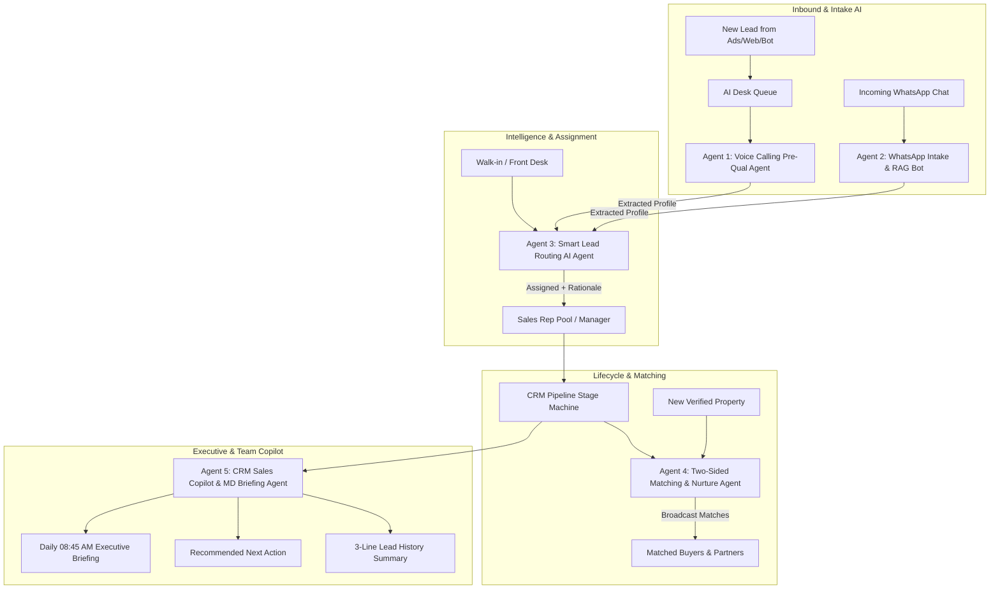

# Omshiv CRM & Property Engine — System Architecture & Design Specification

- **Date:** 2026-11-22
- **Author:** Gopal / Engineering Team
- **Document Version:** 1.0.0
- **Status:** Draft for Builder Review
- **Reference Docs:**
  - `document/Omshiv CRM — Developer Handover for Gopal.pdf`
  - `document/Omshiv CRM — Implementation Plan.pdf`
  - `document/Property Posting Specification.pdf`

---

## 1. Intent and Why

Omshiv Buildvision is transitioning from legacy Google Sheets and Google Apps Script to an enterprise-grade, domain-hosted property CRM, public web portal, mobile application, and AI automation suite.

The legacy architecture suffered from critical operational vulnerabilities:
- Hardcoded personnel logic in scripts; when staff departed, lead routing broke.
- Data drift across multiple disconnected sheets and forms.
- Re-enquiry mishandling, duplicate lead IDs, and incorrect budget parsing (e.g., reading "1–5 Cr" as 15 Cr).
- Unreliable WhatsApp message delivery reporting and lack of auditability.

The purpose of this project is to build a centralized, single-source-of-truth platform that unifies buyer acquisition, inventory onboarding, channel partner distribution, AI-assisted pre-qualification, and automated property-buyer matching.

---

## 2. Goals, Non-Goals, and Anti-Goals

### 2.1 Goals
- **Strict Role & Employee ID Architecture:** Every actor is identified by a system-generated ID (`EMP-XXXX`, `CP-XXXX`). Routing, approval queues, targets, and notifications bind strictly to roles, departments, and IDs—never personal names.
- **Settings-Driven Engine:** Approximately 90 core business rules (assignment algorithms, SLA windows, VIP thresholds, commission slabs, stage transitions, quiet hours) are configurable via an MD settings table with complete audit logging.
- **Single Intake Pipeline:** All inbound channels (Website, Meta Lead Ads, Google Ads, WhatsApp Bot, Front Desk, Sales manual entry, Channel Partners, AI Voice) pass through one unified Intake API with standard validation, mobile normalization, and deterministic ID allocation (`OB-YYYY-NNNN`).
- **Complete Property Taxonomy Integration (Propira Rebuild):** Full native schema and API support for 3 listing types (Sale, Rent, PG), 4 categories (Residential, Commercial, Agriculture, Industry), and 12 sub-categories with specific attribute tables and strict server-side validation.
- **100% Dynamic Admin-Controlled Property Master Options:** Every dropdown, option list, amenity checkbox, area unit, ownership type, and sub-type in the Property Posting engine is 100% dynamic and configurable by the MD/Admin from the admin panel. Zero hardcoded enum lists or choice arrays in frontend or backend application code.
- **Deterministic Two-Sided Matching:** Automated matching between verified listings (`OP-YYYY-NNN`) and active buyer requirement cards based on location, budget tolerance ($\pm 15\%$), property type, and transaction intent.
- **Multi-Channel Automation:** Two-way WhatsApp Business API integration (via DoubleTick) for automated lead qualification, SLA escalation, site visit reminders, and feedback collection; abstracted AI voice calling for automated pre-qualification.
- **Channel Partner Ecosystem:** Partner tiers (Associate, Partner, Premium Partner) with lead submission, 90-day lead protection, and transparent commission lifecycle tracking (`Due` $\to$ `Approved` $\to$ `Paid`).

### 2.2 Non-Goals
- **Post-Won Accounting & Financial Ledger:** The CRM boundary strictly terminates at `Won`. Complex financial disbursements, escrow accounts, builder reconciliations, and payroll live in external accounting systems.
- **Custom In-House Telephony:** Omshiv will not develop a proprietary PBX or VoIP telecom stack; AI voice agents integrate via external provider webhooks and APIs.
- **Direct WhatsApp Group Scraping:** The system will not attempt illicit scraping or unofficial client emulation that exposes Omshiv's business numbers to Meta bans.

### 2.3 Anti-Goals
- **No Hardcoded Employee Logic:** No developer code commits required to reassign portfolios, add departments, or change escalation targets.
- **No Direct DB Writes from Third Parties:** Web forms and ad webhooks never write directly into database tables; every record passes through intake sanitization, duplicate checks, and test-number filters.
- **No Public Exposure of Confidential Listing Data:** Seller identity, direct mobile number, internal legal notes, and floor reserve prices are strictly prohibited from public API responses.
- **No Automated State Tampering on Terminal Leads:** Bulk cron jobs and automated re-engagement workflows must never alter records marked `Won`, `Lost`, or `DND`.

---

## 3. Approaches Considered and Selection

### 3.1 Evaluated Approaches
1. **Option A: Master Architecture Blueprint + Modular Phased Milestone Plans (Selected)**
   - *Description:* Create a single comprehensive technical architecture and data dictionary document, accompanied by four decoupled, testable milestone plans (Core Foundation, Web & Partners, Automations, Operations & Migration).
   - *Pros:* Decouples infrastructure setup from high-risk external integrations; enables parallel work streams; ensures strict interface contracts.
   - *Cons:* Requires disciplined upfront schema mapping.
2. **Option B: Single Consolidated Master Plan**
   - *Description:* A single 50+ page document covering all 10 phases sequentially.
   - *Pros:* Everything in one place.
   - *Cons:* Impractical for subagents to execute due to context limits; difficult to review and iterate incrementally.
3. **Option C: Immediate Execution Plan (Phases 0 & 1 Only)**
   - *Description:* Plan only Phase 0 and Phase 1, ignoring subsequent phases until Phase 1 exits.
   - *Pros:* Quickest to start writing code.
   - *Cons:* High risk of schema refactoring when later phases (such as Propira property fields or AI calling) emerge.

### 3.2 Decision
**Option A** was selected by the project stakeholder. It provides upfront schema stability while allowing modular, bite-sized TDD execution across delivery milestones.

---

## 4. System Architecture & Tech Stack

```mermaid
flowchart TD
    subgraph Inbound Channels
        W[Next.js Public Website]
        M[Meta & Google Ads]
        WA_In[WhatsApp Bot DoubleTick]
        FD[Front Desk / Sales App]
        CP_In[Channel Partner Portal]
        AI_In[AI Voice Agent]
    end

    subgraph API & Backend
        Intake[Intake API Service]
        Auth[JWT / OTP Auth Service]
        Rules[Settings & Assignment Engine]
        Match[Property Matching Service]
        SLA[SLA & Escalation Cron Jobs]
        FastAPI[FastAPI Application Core]
    end

    subgraph Data Layer
        PG[(PostgreSQL Primary DB)]
        Redis[(Redis Cache & Task Queue)]
    end

    subgraph Applications
        CRM_Web[React Vite Admin & Sales CRM]
        RN_App[React Native Mobile App]
        Web_Public[Next.js Public Portal]
    end

    Inbound Channels --> Intake
    Intake --> FastAPI
    FastAPI --> PG
    FastAPI --> Redis
    SLA --> Redis
    CRM_Web --> FastAPI
    RN_App --> FastAPI
    Web_Public --> FastAPI
```

### 4.1 Technology Stack & AI Layer
- **Backend Service:** Python 3.11+, FastAPI (Async REST API, Pydantic v2 data models, SQLAlchemy 2.0 ORM, Alembic migrations).
- **Primary Database:** PostgreSQL 15+ (Relational integrity, strict foreign keys, sequence generators for IDs, JSONB for dynamic attributes).
- **Caching & Task Queue:** Redis 7+ and Celery / ARQ (asynchronous background jobs, SLA escalation timers, WhatsApp webhook processing, AI call queue dispatch).
- **Internal CRM Web App:** React 18, Vite, TypeScript, TailwindCSS, TanStack Query, Lucide Icons.
- **Public Portal:** Next.js 14 (App Router, Server Components, Incremental Static Regeneration for property pages).
- **Mobile Application:** React Native (Expo / bare workflow), cross-platform Android & iOS targeting sales staff and partners.
- **AI Automation & LLM Orchestration:**
  - Pluggable AI Voice Calling Agent API (e.g. Bland.ai / Retell AI / ElevenLabs Conversational + Webhooks).
  - LLM Orchestrator (Google Gemini 1.5 Flash / Pro via API or LangChain/LlamaIndex) for conversational extraction, lead summarization, and RAG knowledge feeds.
  - DoubleTick WhatsApp Business API (Webhooks for 2-way message flow, interactive template messages).
- **Storage & Infrastructure:** AWS S3 / Cloudflare R2 (presigned media uploads for site visit photos, property brochures, audio call recordings).

---

## 5. Domain Data Models & Schema Design

### 5.1 Identity & Access Management
- `departments`: `id`, `name`, `code`, `is_active`, `created_at`.
- `roles`: `id`, `department_id`, `name`, `code` (`MD`, `SALES_HEAD`, `SALES_MANAGER`, `SALES_EXEC`, `FRONT_DESK`, `CP_MANAGER`, `CP_EXEC`, `TECH_ADMIN`), `permissions` (JSONB).
- `employees`:
  - `employee_id` (PK, varchar `EMP-XXXX`, unique, indexed)
  - `name`, `email` (unique), `mobile` (10-digit normalized, unique)
  - `department_id`, `role_id`, `level` (int)
  - `reporting_to` (FK to `employees.employee_id`, nullable)
  - `leave_approver` (FK to `employees.employee_id`, nullable)
  - `handled_categories` (text array: `Residential`, `Commercial`, `Agriculture`, `Industry`)
  - `budget_min_cr`, `budget_max_cr` (numeric)
  - `is_active` (boolean), `join_date` (date)
- `auth_sessions`: `id`, `entity_type` (`EMPLOYEE`, `PARTNER`), `entity_id`, `session_token`, `otp_hash`, `otp_expires_at`, `expires_at`, `created_at`.

### 5.2 System Settings & Audit Ledger
- `system_settings`:
  - `key` (PK, varchar, e.g. `sla_untouched_hours`, `repeat_enquiry_window_days`)
  - `value` (JSONB)
  - `data_type` (`INT`, `STRING`, `BOOLEAN`, `JSON`, `DECIMAL`)
  - `category` (`ASSIGNMENT`, `SLA`, `MATCHING`, `WHATSAPP`, `COMMISSION`, `RENT`)
  - `description` (text)
  - `updated_by` (FK to `employees.employee_id`)
  - `updated_at` (timestamp)
- `audit_logs`: `id`, `entity_name`, `entity_id`, `action` (`CREATE`, `UPDATE`, `DELETE`, `TRANSFER`), `performed_by` (`employee_id`), `old_values` (JSONB), `new_values` (JSONB), `ip_address`, `timestamp`.

### 5.3 Inbound Leads & Buyer Lifecycle
- `leads`:
  - `lead_id` (PK, format `OB-YYYY-NNNN`, sequence backed, immutable)
  - `source` (`WEBSITE`, `META`, `GOOGLE`, `WHATSAPP_BOT`, `FRONT_DESK`, `SALES_SELF`, `MD`, `PARTNER`, `AI_CALL`)
  - `full_name`, `mobile` (varchar `91XXXXXXXXXX`, indexed)
  - `email`, `lead_type` (`BUYER`, `SELLER`, `RENT`)
  - `current_stage` (`AI_DESK`, `NEW`, `ATTEMPTING`, `CONNECTED`, `REQ_CAPTURED`, `QUALIFIED`, `MEETING_PLANNED`, `SITE_VISIT_PLANNED`, `SITE_VISIT_DONE`, `NEGOTIATION`, `WON`, `LOST`, `NURTURE`)
  - `temperature` (`HOT`, `WARM`, `COLD`)
  - `assigned_to` (FK to `employees.employee_id`, nullable while in `AI_DESK` or if assigned to CP)
  - `assigned_cp_id` (FK to `channel_partners.partner_id`, nullable; used for high-rent or partner-exclusive leads)
  - `channel_partner_id` (FK to `channel_partners.partner_id`, nullable; partner who sourced the lead)
  - `partner_protection_until` (timestamp, nullable)
  - `assignment_mode` (`AI_AGENT`, `RULE_ROUND_ROBIN`, `MANUAL_OVERRIDE`, `SELF_CREATED`)
  - `ai_routing_reason` (text, explainable routing rationale logged by AI assignment agent)
  - `ai_routing_confidence` (numeric 0.00–1.00)
  - `is_vip` (boolean, default false)
  - `is_test` (boolean, default false)
  - `dnd_status` (boolean, default false)
  - `linked_previous_lead_id` (FK to `leads.lead_id`, nullable)
  - `utm_source`, `utm_medium`, `utm_campaign`, `ad_set_id`, `ad_id`
  - `created_at`, `updated_at`
- `requirement_cards`:
  - `id`, `lead_id` (FK, unique)
  - `intent` (`BUYER_SELF_USE`, `BUYER_INVESTOR`, `SELLER`, `RENT`)
  - `category` (`RESIDENTIAL`, `COMMERCIAL`, `AGRICULTURE`, `INDUSTRY`)
  - `sub_category_code` (int, 1–13)
  - `property_type`, `stream`, `zone`, `colony`
  - `budget_min_cr` (numeric), `budget_max_cr` (numeric)
  - `timeline_days` (int), `purpose` (text)
  - `ai_suggestions` (JSONB), `is_confirmed_by_agent` (boolean)
- `lead_activities`:
  - `id`, `lead_id`
  - `action_type` (`CALL`, `WHATSAPP`, `REQUIREMENT`, `MEETING`, `VISIT`, `TRANSFER`)
  - `outcome` (varchar, e.g. `Connected`, `Visit Completed`, `Rescheduled`)
  - `note` (text)
  - `next_action` (text)
  - `follow_up_date` (timestamp, mandatory for open leads)
  - `logged_by` (FK to `employees.employee_id`)
  - `created_at` (timestamp)
- `lost_lead_details`: `id`, `lead_id`, `reason_code`, `remarket_class` (`WITHIN_6_MONTHS`, `AFTER_6_MONTHS`, `NEVER_CONTACT_DND`), `notes`.
- `nurture_lead_details`: `id`, `lead_id`, `reason`, `revive_date` (date), `is_revived` (boolean).

### 5.4 Seller Inventory & Dynamic Propira Property Engine

#### 5.4.1 Dynamic Property Master Data & Options (100% Admin-Controlled)
To ensure **zero hardcoded options** anywhere in the system, all choices, dropdown values, units, and checkbox amenities are stored in relational master data tables managed via the Admin Panel:

- `property_master_groups`:
  - `group_key` (PK, varchar, e.g. `FACING`, `FLOORING`, `POSSESSION`, `TRANSACTION`, `OWNERSHIP`, `RENTAL_ALLOWED_FOR`, `FURNISHED_STATUS`, `FURNITURE_ITEMS`, `WHICH_PART`, `AREA_UNITS`, `SOURCE_TYPE`, `AMENITIES`, `NEARBY_TAGS`, `PG_AVAILABLE_FOR`, `PG_ROOM_TYPES`)
  - `name` (varchar, e.g. "Property Facing Options", "Flooring Types", "Area Units")
  - `description` (text)
  - `allow_multiple` (boolean, indicates whether form renders single dropdown or multi-select/checkboxes)
  - `is_system` (boolean, prevents accidental deletion of essential system keys)
  - `created_at` (timestamp)
- `property_master_options`:
  - `id` (PK, serial / uuid)
  - `group_key` (FK to `property_master_groups.group_key`, indexed)
  - `option_code` (varchar/int, preserves legacy codes like 1, 2, 3 so historical data migrates seamlessly)
  - `label` (varchar, e.g. "North-East", "Granite", "Biswa", "Power Backup", "Beds")
  - `applicable_categories` (int array / JSONB, e.g. `[1, 2]` — scopes options so "Bigha" only appears for Agriculture, "Lift" only appears for Apartments/Commercial)
  - `applicable_sub_categories` (int array / JSONB, optional finer scoping)
  - `display_order` (int, controls visual order in frontend dropdowns)
  - `is_active` (boolean, default true; deactivated options are hidden from new posts but preserved on existing ads)
  - `metadata` (JSONB, e.g. unit multiplier conversion to sq.ft, SVG icon name for amenities)
  - `created_by` (FK to `employees.employee_id`)
  - `updated_at` (timestamp)

#### 5.4.2 Core Property & Attribute Schemas
- `properties`:
  - `listing_id` (PK, format `OP-YYYY-NNN`, sequence backed)
  - `listing_type` (FK to `property_master_options` where group=`LISTING_TYPE`: Rent=1, Sale=2, PG=3)
  - `category_code` (FK to `property_master_options` where group=`CATEGORY`: 1=Residential, 2=Commercial, 3=Agriculture, 4=Industry)
  - `sub_category_code` (FK to `property_master_options` where group=`SUB_CATEGORY`: 1=Flat, 2=House, 4=ResPlot, 5=Shop, 6=Office, 7=CommPlot, 8=AgriLand, 9=Farmhouse, 10=IndPlot, 11=Warehouse, 12=ColdStorage, 13=Factory)
  - `sub_type_code` (FK to `property_master_options` where group=`SUB_TYPE`, nullable)
  - `state`, `city` (defaults to "Alwar", configurable in settings), `sub_locality`, `location_address`, `street_no`, `pincode`
  - `latitude`, `longitude` (decimal, mandatory map pin; submission blocked without it)
  - `expected_price` (numeric, greater than 0)
  - `price_type` (FK to `property_master_options`: `TOTAL`, `PER_UNIT`)
  - `price_per_unit` (numeric, auto-calculated as price ÷ area)
  - `price_negotiable` (boolean)
  - `facing_code` (FK to `property_master_options` where group=`FACING`)
  - `corner_property` (boolean)
  - `description` (text)
  - `ownership_type_code` (FK to `property_master_options` where group=`OWNERSHIP`)
  - `status` (`UNVERIFIED`, `PENDING_VERIFICATION`, `VERIFIED_AVAILABLE`, `HOLD`, `SOLD`, `RENTED`, `WITHDRAWN`, `REJECTED`, `EXPIRED`)
  - `rejection_reason` (text, nullable)
  - `is_live_website` (boolean, default false)
  - `public_price_mode` (`EXACT`, `BAND`, `ON_REQUEST`)
  - `is_investment_grade` (boolean, default false)
  - `listed_by_type` (`EMPLOYEE`, `OWNER`, `PARTNER`, `FRONT_DESK`)
  - `listed_by_id` (varchar, employee ID or partner ID)
  - `expires_at` (timestamp, nullable; auto-calculated as +90 days for sale, +30 days for rent upon going live)
  - `created_at`, `verified_at`, `sold_at`
- Sub-category specific child tables (1-to-1 with `properties`):
  - `prop_residential_flats`: `bhk`, `rooms` (must equal BHK unless Studio), `total_floors`, `property_floor` ($\le$ total_floors), `balconies`, `bathrooms`, `super_area`, `super_area_unit_id`, `carpet_area`, `carpet_area_unit_id` (enforced carpet < super), `flooring_code`, `furnished_status_code`, `furniture_item_ids` (int array referencing `property_master_options`), `transaction_type_code`, `possession_status_code`, `construction_age`.
  - `prop_houses_villas`: `constructed_floors`, `plot_area`, `plot_unit_id`, `rooms`, `kitchens`, `bathrooms`, `balconies`, `facing_road_width_ft`, `flooring_code`, `furnished_status_code`, `transaction_type_code`, `possession_status_code`.
  - `prop_plots`: `plot_area`, `plot_unit_id`, `boundary_wall` (bool), `facing_road_width_ft`.
  - `prop_commercial`: `total_floors`, `sell_part_code`, `floor_level`, `super_area`, `carpet_area`, `road_width_ft`.
  - `prop_agriculture`: `area`, `unit_id` (Bigha, Biswa, Acre, Hectare), `boundary` (bool), `road_width_ft`, `corridor_distance_expressway_km`.
  - `prop_industrial_warehouses`: `plot_area`, `covered_area`, `storage_capacity_mt` (for cold storage), `shed` (bool), `office` (bool), `toilet` (bool).
  - `prop_pg`: `pg_name`, `available_for_code`, `gender`, `room_type_code`, `food_included` (bool), `meals_type_code`, `notice_period_days`, `electricity_charges_type`.
- `property_amenity_mappings`: `property_id`, `option_id` (FK to `property_master_options` where group=`AMENITIES`).
- `property_nearby_distances`: `property_id`, `tag_option_id` (FK to `property_master_options` where group=`NEARBY_TAGS`), `distance_km` (decimal).
- `property_media`: `id`, `property_id`, `media_type` (`PHOTO`, `VIDEO_LINK`, `MAP`), `url`, `display_order`, `is_cover` (boolean).
- `property_verification`: `property_id`, `verified_by_emp_id`, `visit_date`, `is_physically_verified`, `area_confirmed`, `photos_genuine_confirmed`, `ownership_confirmed`, `verifier_notes`, `manager_approval_emp_id`, `approved_at`.

### 5.5 Channel Partners & Commissions
- `channel_partners`: `partner_id` (PK, `CP-XXXX`), `name`, `mobile` (unique), `email`, `city`, `level` (`ASSOCIATE`, `PARTNER`, `PREMIUM`), `status` (`PROSPECT`, `CALLED`, `QUALIFIED`, `ONBOARDED`, `ACTIVE`, `WARNING`, `REMOVED`), `assigned_cp_manager_id`, `agreement_signed_date`, `created_at`.
- `partner_commissions`: `id`, `lead_id`, `property_id`, `partner_id`, `deal_value`, `commission_amount`, `status` (`DUE`, `APPROVED`, `PAID`), `due_date`, `paid_date`, `approved_by_emp_id`.

---

## 6. Business Logic & Engine Specifications

### 6.1 Intake & De-duplication Engine
1. **Source Token Validation:** Reject and log unauthorized webhook payloads.
2. **Mobile Normalization:** Strip spaces, leading zeros, and prefixes to store standard 10-digit format (`91XXXXXXXXXX`).
3. **Test Lead Filter:** Numbers present in the `test_numbers` table receive `is_test = true` and are blocked from production reports, SMS/WhatsApp triggers, and AI calling.
4. **Repeat Enquiry Decision Matrix:**
   - Same mobile within 24 hours: Silently ignore with an intake audit log entry.
   - Active open lead ($< 45$ days): Do not create duplicate lead. Append an activity note to existing lead and create an urgent task for the owner: *"Repeat enquiry received — re-confirm requirements"*.
   - Closed lead (`Won`/`Lost`) OR last enquiry $> 45$ days: Generate a new lead record (`OB-YYYY-NNNN`) with `linked_previous_lead_id` set to original. Auto-route to the original owner employee if category matches.

### 6.2 Assignment & Routing Engine (AI Agent & Rules Powered)
- **Routing Decision Hierarchy:**
  1. **Direct Creator Lock:** Direct Employee or MD entry stays with creator (`Listed By` / `Owner`).
  2. **Direct Inventory Enquiry:** Web listing enquiry ("I'm interested" on property page) is assigned directly to the listing's verified owner employee.
  3. **AI Smart Lead Router (Default for Inbound Traffic):** For all inbound digital leads (post AI pre-qualification or direct intake), **Agent 3 (AI Lead Routing Agent)** analyzes lead attributes (budget, category, location, urgency, buyer temperature) against sales rep performance profiles (historical win rates, sub-market expertise, current lead capacity, active shift/leave status) and assigns the lead with an explainable `ai_routing_reason` and `ai_routing_confidence` score.
  4. **Rule Table & Round-Robin Fallback:** If AI Routing confidence is below threshold or disabled in settings, falls back to the deterministic MD assignment rules table (category, location zone, budget band $\to$ round-robin pool).
  5. **Hard Operational Guardrails:**
     - **Leave Cover Check:** If target employee is on approved leave in HR table, auto-reroutes to `cover_employee_id`.
     - **Capacity Cap Check:** If target employee's open lead volume reaches `capacity_cap` (e.g. 25 active leads), automatically overflows to the least-loaded qualified peer.
     - **System Default:** Unmatched leads route to system `default_owner_id`.
  6. **Automated WhatsApp Introduction:** Once assigned, dispatches an automated WhatsApp message to the buyer introducing their dedicated property advisor with a digital visiting card, and instantly alerts the employee with the AI summary dossier.

### 6.3 SLA & Escalation Engine
- **3-Hour Untouched Reminder:** Lead in `NEW` with no activity logged for 3 hours $\to$ WhatsApp reminder to owner.
- **24-Hour Manager Escalation:** Lead untouched after 24 hours $\to$ WhatsApp escalation to employee's reporting manager.
- **Hot/VIP Escalation:** Unattended Hot or VIP lead ($Budget \ge 2\text{ Cr}$ Urban, $\ge 10\text{ Cr}$ Agro/Ind) untouched for 3 hours $\to$ immediate alert to both owner and Sales Head.
- **Quiet Hours Enforcement:** 21:00 to 08:30 IST. No staff alerts or marketing outbound messages during quiet hours (except critical login OTPs). Night-time leads aggregate into a 10:00 AM *"Today's Work"* digest.

### 6.4 Two-Sided Property Matching Engine
- **Forward Match (New Listing Verified):**
  - Search open buyer leads (`NEW`, `ATTEMPTING`, `CONNECTED`, `REQ_CAPTURED`, `QUALIFIED`).
  - Criteria: `category` matches, `zone/colony` matches (or buyer specified "Any"), listing price is within buyer requirement $\pm 15\%$ budget tolerance.
  - Generates listing summary alert to matched buyers' owner employees.
- **Reverse Match (Buyer Reaches Qualified):**
  - Instant query returns top 5 matching verified properties on the lead detail screen with 1-tap WhatsApp brochure dispatch.

---

### 6.5 Property Expiration & Renewal Lifecycle
- **Listing Validity:** Verified Sale listings remain live for 90 days; Rent listings remain live for 30 days (both configurable in system settings).
- **Daily Expiration Scheduled Task:** Runs daily at 00:30 IST. When `expires_at < NOW()` and status is `VERIFIED_AVAILABLE`, sets status to `EXPIRED`, flips `is_live_website = false`, and purges Next.js cache. Direct public URL hits return a polite *"No longer available"* screen with matching recommendations.
- **Renewal Alerts:** Automated WhatsApp notification dispatched to the listing owner 3 days prior to expiration with a 1-tap renew link.

### 6.6 WhatsApp Communications & Shared Inbox Boundary
- **Transactional & Event Outbound:** Automated messages (OTP, assignment notifications, reminders, match broadcasts, feedback requests) are processed directly by FastAPI and the DoubleTick REST API with real delivery status webhooks (`sent`, `delivered`, `read`, `failed`).
- **Conversational 1-to-1 Messaging:** Sales executives and managers interact with leads via one-tap WhatsApp deep links (`https://wa.me/` / DoubleTick web & mobile apps). All incoming webhook messages from DoubleTick are recorded in the lead's activity timeline, keeping the CRM lean and avoiding the massive overhead of building a duplicate custom WebSocket chat engine.

### 6.7 Dynamic Master Option Engine & Admin Governance
Every single dropdown, unit, amenity, and choice in the Property Posting Engine is 100% dynamic and editable from the MD/Admin Panel:
1. **Zero Hardcoded Enums:** Frontend components (React, React Native, Next.js) and backend validators never define hardcoded arrays for facing directions, flooring types, possession stages, ownership documents, rental tenant permissions, or amenities. All forms dynamically fetch their schema definitions from `/v1/public/property-schema` (cached in Redis, invalidated on admin edit).
2. **Category & Sub-Category Scoping:** When the MD creates or edits an option in the Admin Panel, they specify which categories/sub-categories it applies to (e.g., *Bigha* is enabled exclusively for Agriculture; *Lift* is enabled for Flats and Commercial buildings, but automatically hidden for Plots).
3. **Safe Soft-Deactivation:** To protect data integrity, options in `property_master_options` cannot be deleted if referenced by existing properties. Instead, setting `is_active = false` hides the option from future property posting forms while preserving it on historical listings and search filters.
4. **Audit Trail on Master Changes:** Every modification to a master option (creating a new flooring type, changing display order, modifying labels) writes an entry to `audit_logs` capturing `performed_by` (`EMP-XXXX`), timestamp, old value, and new value.

---

## 7. AI Agent Automation Framework & Architecture

The Omshiv platform integrates five purpose-built autonomous and semi-autonomous AI agents designed to eliminate repetitive operational overhead, intelligently distribute leads, optimize customer conversions, and furnish executive intelligence.



### 7.1 Agent 1: Outbound AI Voice Calling Agent (Pre-Qualification)
- **Role & Objective:** Automatically calls newly generated leads from online ads, landing pages, and campaign buttons to screen out casual clicks, determine genuine buying/selling intent, and capture key parameters before sales executives spend time calling.
- **Calling Window & Guardrails:**
  - Active only between 10:00 and 19:00 IST, Monday through Saturday.
  - Skips leads manually entered by Front Desk, Sales Executives, MD, or Channel Partners.
  - Skips numbers marked DND or flagged as test leads.
  - Target call duration: 60 to 90 seconds.
- **Conversational Protocol (Hindi / Hinglish / English):**
  1. Opening greeting tailored to traffic source (e.g. *"Namaste, main Omshiv Buildvision se baat kar raha hoon aapki recent property enquiry ke baare mein..."* — never mentions "Facebook" to a WhatsApp lead).
  2. Qualification queries: Intent (Buy vs Sell vs Rent), property category (Residential, Commercial, Agro, Industry), preferred area/colony, budget range, and timeline.
  3. Callback coordination: Inquires about the best time for a senior property advisor to connect.
- **Knowledge Base RAG (Hourly Inventory Feed):**
  - Receives an hourly sanitized JSON feed of active verified properties (category, zone, size, price band — zero seller names, phone numbers, or exact addresses).
  - Enables the voice agent to answer naturally: *"Haanji, hamare paas Alwar bypass aur Tijara road par 2 aur 3 BHK flats available hain ₹45 Lakh se ₹70 Lakh ke budget mein."*
- **Safety & Cancellation Rule (Crucial):**
  - Pre-dial validation webhook checks live lead state immediately before initiating dialing.
  - If a human agent logs a manual call, updates a note, or moves the lead stage, the pending AI call is instantly aborted.
- **Result Processing & Ingestion:**
  - Short calls (< 20 seconds or no speech) count as unanswered; queued for up to 3 retry attempts over configured cadences (1h, 24h, 48h).
  - Successful calls webhook the call recording URL, audio transcription, and structured JSON extract (intent, category, budget min/max, zone, timeline, temperature `Hot/Warm/Cold`).
  - System populates Requirement Card suggestions for 1-tap confirmation by the sales rep and marks stage as `PRE_QUALIFIED`.

### 7.2 Agent 2: WhatsApp Conversational Intake & Property RAG Bot
- **Role & Objective:** Operates 24/7 on the official DoubleTick WhatsApp Business API number to handle inbound messaging from click-to-WhatsApp ads, website chat widgets, and QR codes.
- **Core Capabilities:**
  - **Conversational Form Filling:** Converses in natural language (or via interactive quick-reply buttons) to capture user requirements without feeling like a rigid web form.
  - **Dynamic Property Recommendation (RAG):** When buyer budget and category are identified, queries the PostgreSQL `properties` table and sends 2–3 matching verified listings complete with high-resolution photo cards, specifications, and *"Interested"* / *"Show More"* action buttons.
  - **Seller Self-Posting Flow:** If user selects "I want to sell/rent", the bot collects preliminary details (type, area, expected price) and generates a pre-filled draft listing in `PENDING_VERIFICATION` with an OTP verification link.
  - **Seamless Human Handoff:** If the client types *"Talk to someone"* or asks an unresolvable complex query, the bot halts auto-replies, immediately tags the assigned sales executive, sends a priority WhatsApp alert, and surfaces the chat in the CRM timeline.
  - **Inactivity Revival:** If a user abandons mid-conversation, sends one gentle follow-up prompt after 2 hours before closing the bot session.

### 7.3 Agent 3: AI Lead Routing & Smart Assignment Agent (Intelligent Lead Router)
- **Role & Objective:** Automatically and optimally matches each incoming qualified or raw lead to the single most effective sales executive in real time, moving far beyond naive round-robin.
- **Scoring & Evaluation Algorithm:**
  1. **Lead Persona & Value:** Evaluates budget ticket size ($< 50\text{ Lakh}$, $50\text{L}–1.5\text{ Cr}$, $> 2\text{ Cr}$ VIP/HNI), property category (Residential vs Commercial vs Farmhouse/Agro vs Industrial), and intent urgency.
  2. **Advisor Performance & Win Velocity:** Analyzes historical win rates and conversion velocity of active sales reps for that specific category, locality, and budget band.
  3. **Capacity & Real-Time Availability:** Checks real-time open lead volume against individual `capacity_cap` (avoids overloading), verifies current working shift, and checks HR leave approval status.
  4. **Geographic & Linguistic Affinity:** Matches lead's preferred micro-location (e.g. Alwar bypass, Tijara road, Bhiwadi) with advisors who have strong local inventory knowledge and geographic focus.
- **Explainable Decision Logging:**
  - Every assignment creates an immutable audit entry and sets `ai_routing_reason` (e.g., *"Assigned to EMP-0004: Highest 90-day win rate (36%) in Bhiwadi ₹1–2 Cr residential segment; current load 14/25"*).
  - Stores `ai_routing_confidence` score (e.g. `0.92`).
- **Safety Overrides & Guardrails:**
  - Hard caps are never violated: if the highest-scoring advisor is at capacity, the agent smoothly overflows to the next best match.
  - Managing Director or Sales Head can reassign any lead in 1 tap; the AI agent learns from reassignments.
- **Instant Two-Way Notification:**
  - **Advisor Alert:** Dispatches an immediate WhatsApp notification with the lead's full AI profile, recording link, and routing justification.
  - **Client Introduction:** Automatically sends a professional WhatsApp message to the buyer introducing the assigned advisor with their contact card and direct call link.

### 7.4 Agent 4: Two-Sided Property Matching & Lifecycle Nurture Agent
- **Role & Objective:** Autonomous background engine that pairs real estate supply and demand while running lifecycle retention workflows.
- **Match Automation:**
  - **Forward Match:** The instant a property is approved as `VERIFIED_AVAILABLE`, the agent scans all open buyer requirement cards within $\pm 15\%$ budget tolerance and matching zone. Dispatches a digest to each buyer's assigned executive (*"Property OP-2026-412 matches 5 of your active clients"*).
  - **Reverse Match:** The moment an advisor confirms a requirement card as `QUALIFIED`, the agent renders top 5 matching verified properties directly onto the lead screen with a 1-tap WhatsApp brochure dispatch button.
- **Automated Lifecycle & Nurture Journeys:**
  - **Nurture Revival:** On the configured `revive_date`, sends an automated check-in template (*"Namaste [Name], kya aap abhi bhi [Location] mein property dekh rahe hain?"* with `Haan / Baad mein / Abhi nahi` buttons). An affirmative tap instantly alerts the owner employee.
  - **Post-Visit & Post-Won Feedback:** Dispatches automated WhatsApp feedback surveys following site visits (1–5 star rating for property and advisor). Low ratings ($\le 2$ stars) trigger an immediate priority escalation to the Sales Head.
  - **Festival & Milestone Campaigns:** Automates anniversary messages (*"1 year since your purchase — looking to invest or rent?"*) and festive greetings with interactive campaign quick-replies.

### 7.5 Agent 5: CRM Sales Copilot & Executive Intelligence Agent (Internal)
- **Role & Objective:** Embedded AI copilot assisting sales executives and leadership inside the CRM web and mobile apps.
- **Key Features:**
  - **Lead Timeline 3-Line Summary:** Condenses multi-week interaction histories (AI calls, staff calls, WhatsApp chats, site visits) into a 3-bullet executive summary rendered at the top of each lead's profile.
  - **Next-Best-Action Recommender:** Suggests the next optimal action (e.g. *"Client requested 3 BHK under 60L; 2 new inventory units verified today in Sectors 8. Recommend scheduling site visit today before 18:00"*).
  - **Daily MD Executive Briefing:** At 08:45 AM daily, generates a concise executive intelligence report for the Managing Director via WhatsApp and admin dashboard:
    1. Yesterday's key pipeline metrics (Leads received, qualified, visits completed, closures).
    2. High-value / VIP leads stuck in pipeline without movement ($> ₹2\text{ Cr}$).
    3. Critical SLA breaches and capacity bottlenecks across sales executives.
    4. Top 5 priority managerial interventions for the day.

### 7.6 AI Quality Feedback Loop & Human-in-the-Loop Governance
- Every AI-extracted requirement is presented to the human sales representative as a *suggested* field with a 1-tap *"Confirm"* or *"Edit"* action.
- Telemetry: Staff rate each AI call outcome as `Correct`, `Partially Correct`, or `Incorrect`.
- Weekly accuracy metrics are tracked on the Tech Admin dashboard to monitor prompt drift, speech recognition accuracy, and conversion efficacy.

---

## 8. What is Left to the Builder

The following technical implementation details are left to engineering discretion:
- Specific UI component styling with TailwindCSS (adhering to clean, high-contrast, mobile-friendly design tokens).
- Exact database connection pool sizing and indexing strategy on composite query filters.
- Asynchronous task worker configuration (Celery vs. ARQ with Redis).
- Specific HTTP client timeouts, retry exponential backoff strategies, and logging formatter configurations.
- Minor partner lead allocation rules for high rent (e.g., standard round-robin among active verified partners in the designated zone).
- Selection of specific voice synthesis model voices and audio codecs for the telephony integration.

---

## 9. Verification & Acceptance Criteria

1. **Schema & Migration:** Clean Alembic migration script executing without errors; foreign key constraints prevent orphaned records.
2. **ID Sequences:** Independent sequences for `OB-YYYY-NNNN` (leads) and `OP-YYYY-NNN` (properties) guaranteed non-reusable and collision-free under concurrent requests.
3. **Access Isolation:** Unauthenticated requests or unauthorized roles (e.g. Sales Executive attempting to read seller phone numbers on inventory they do not own) return strict 403 Forbidden responses.
4. **Validation Proof:** Attempting to post a property with $Carpet Area \ge Super Area$ fails with HTTP 422 Unprocessable Entity.
5. **Intake De-duplication:** Submitting identical mobile numbers within 24 hours results in exactly one database lead record.
6. **AI Safety Gate:** Triggering a manual lead stage transition while an AI voice call is queued immediately revokes the call job and emits an audit event.
7. **Matching Tolerance:** Verified property priced at ₹1.10 Cr correctly matches a buyer requirement card with budget range ₹0.80–₹1.00 Cr under the default $\pm 15\%$ tolerance setting.

